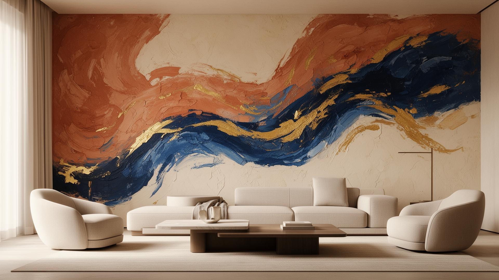
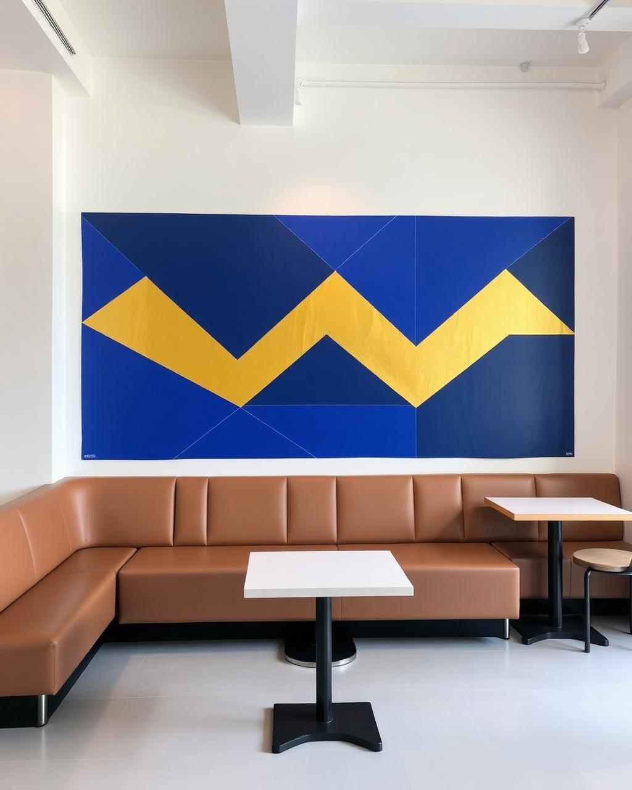
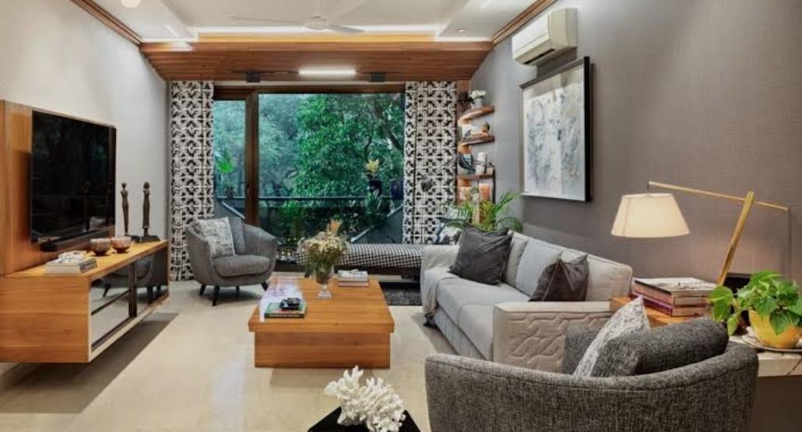

# MJR Studio — Wall Art, Murals & Interior Design Website

A responsive studio website showcasing wall printing, custom murals, residential and commercial interior projects, and a gallery of completed work. The page is structured as a single-scroll studio experience with service discovery, portfolio sections, testimonials, and contact actions.

## Visual preview

The repository includes local gallery imagery used by the website. These are project visuals, not screenshots of the application UI.

| Wall-art portfolio | Interior project |
|---|---|
|  |  |

## Visitor journey

~~~mermaid
flowchart TD
    A["Visitor lands on MJR Studio"] --> B["Discover services"]
    B --> C["Browse wall-art portfolio"]
    B --> D["Browse interior projects"]
    C --> E["Review project imagery and details"]
    D --> E
    E --> F["Read process and testimonials"]
    F --> G["Request a quote / contact studio"]
~~~

## Site sections

- **About:** introduces the studio and creative approach.
- **Services:** wall printing, interior design, and custom projects.
- **Wall art gallery:** mural and wall-print portfolio examples.
- **Interiors gallery:** residential and commercial interior imagery.
- **Process and reviews:** explains the customer journey and displays testimonials.
- **Contact:** quote request links, social links, and WhatsApp contact affordance.

## Tech stack

- React 19 and TypeScript
- TanStack Start and TanStack Router
- Vite 7
- Tailwind CSS 4
- Radix UI primitives and Lucide icons
- Cloudflare Vite integration

## Run locally

~~~bash
npm install
npm run dev
~~~

Create a production build with npm run build. Run static lint checks with npm run lint.

## Evidence and limitations

The gallery images are checked-in content assets. This repository does not publish conversion analytics, Lighthouse performance results, or automated end-to-end test coverage, so no business outcome or performance benchmark is claimed here.

## Why it matters

A design studio benefits from a clear visual portfolio: visitors can understand the kind of work offered, compare styles, and find a direct way to request a consultation.
